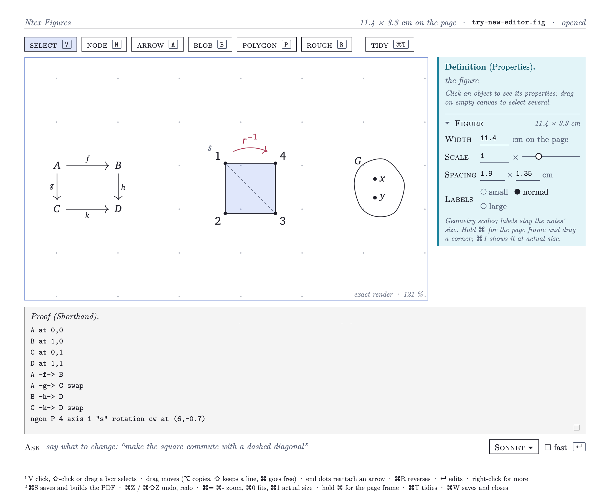
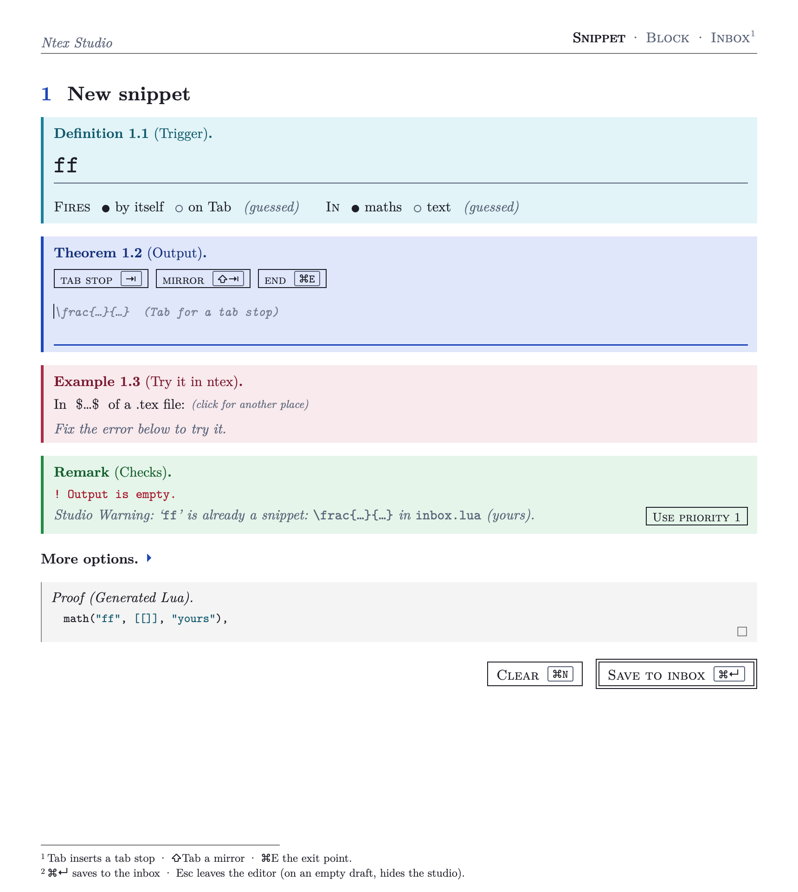
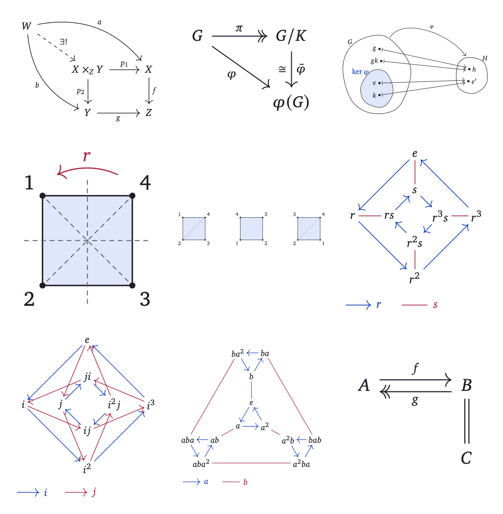
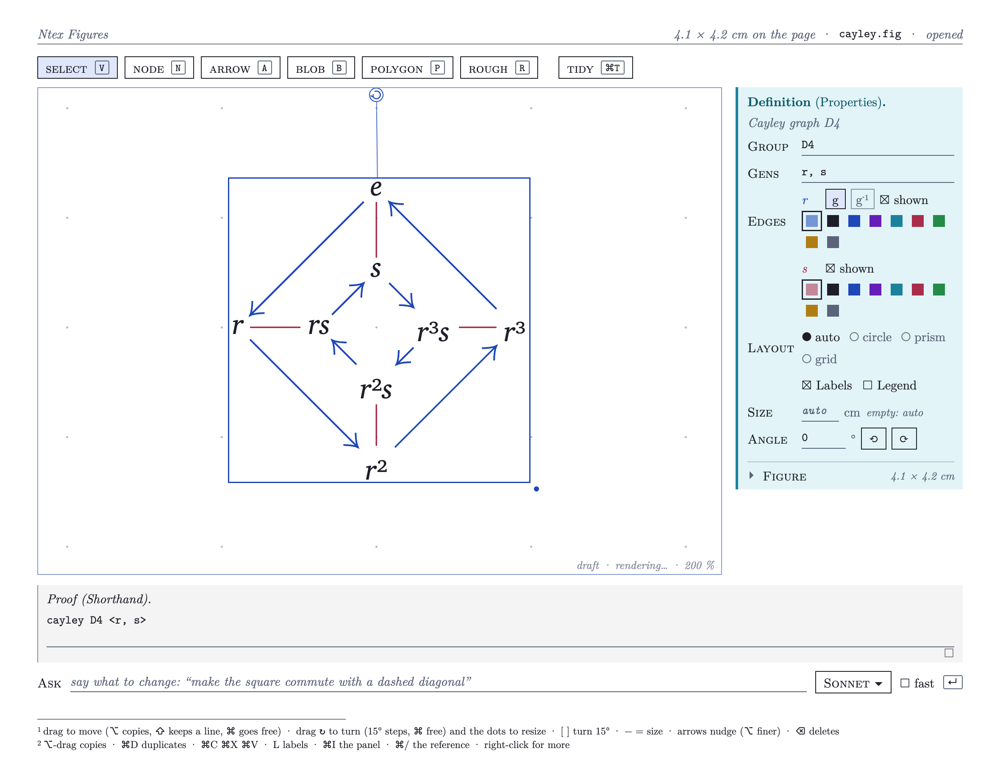
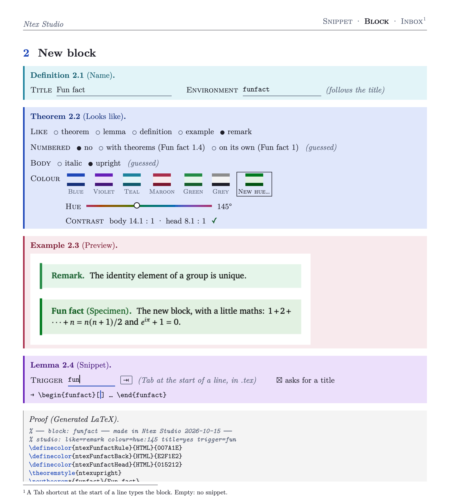
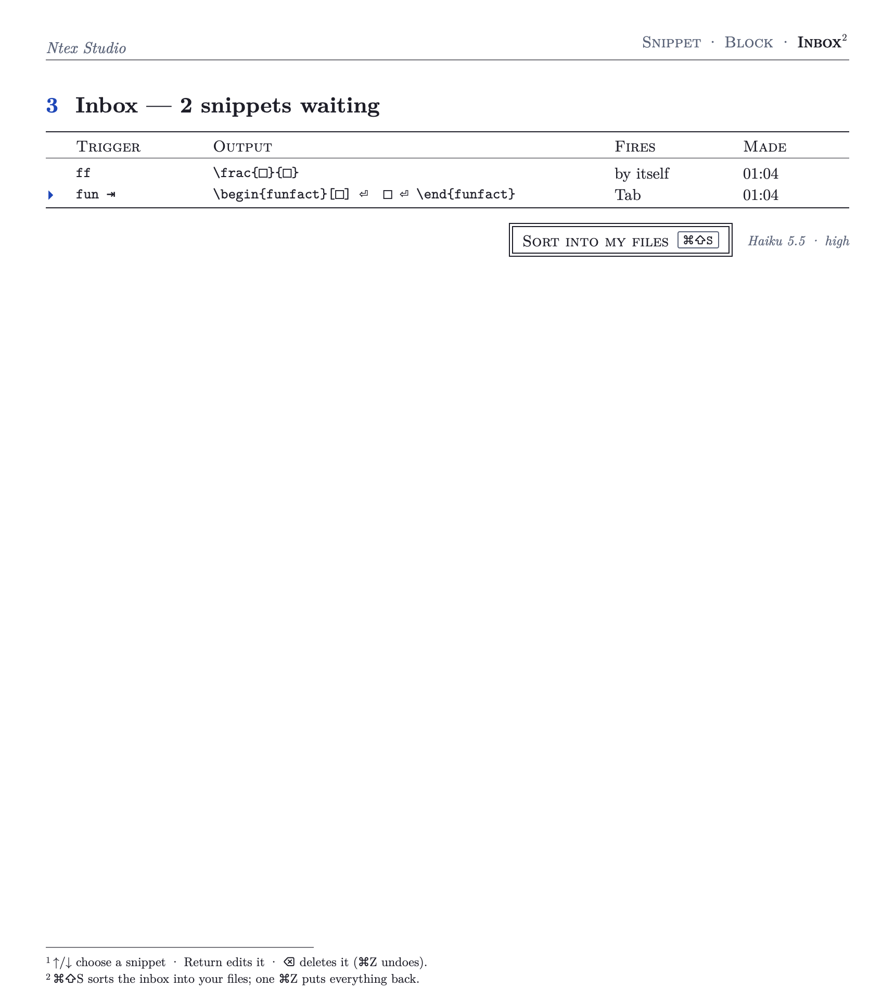

# ntex

**Fast live LaTeX in Neovim, plus two small native apps for the parts typing is bad at.**

ntex is a self-contained Neovim setup for writing mathematics as fast as you
can think it: lecture notes, problem sets, scratch work. Snippets expand as you
type (`mk` → `$…$`, `x2` → `x_{2}`, `//` → `\frac{}{}`), the PDF recompiles
whenever you pause, and errors land on the line that caused them. It runs
beside your normal Neovim (`NVIM_APPNAME=texnvim`) and never touches
`~/.config/nvim`.

Two companion apps (macOS, Rust + GPUI) cover what a terminal can't:

- **Ntex Studio** makes new snippets, Tab shortcuts and theorem-like blocks
  mid-lecture. Type a trigger and an output, press ⌘↵, and the snippet is live
  in every open ntex.
- **Ntex Figures** draws commutative diagrams, Cayley graphs, blob diagrams
  and polygons. A figure is a short text file (`figures/x.fig`) that compiles
  to TikZ and PDF; you can edit it as text, on a canvas, or by asking a model.

| Ntex Figures | Ntex Studio |
| --- | --- |
|  |  |

<details>
<summary>More renderings</summary>

Figures built from `.fig` shorthand (pullback, first isomorphism theorem,
kernel blob, D4 symmetries, Cayley graphs of D4, Q8 and A4, an equaliser):



A Cayley graph selected in the figure editor, with its properties panel:



Ntex Studio's block page (a new theorem-like environment with a live preview)
and the inbox of snippets waiting to be sorted:




All renderings are produced by the apps' own offscreen render tests; no window
was opened to make them.
</details>

> **The snippets are personal.** `snippets/tex/*.lua` is one person's
> collection, carried over from Obsidian's Latex Suite and tuned to their
> fingers. Many triggers are idiosyncratic (`Nat`, `disj`, `odp`, `lmd` …),
> some override upstream defaults, and the notes theme (`templates/tex/`) is a
> particular look. Treat them as a working example: keep what suits you and
> rewrite the rest. The snippet vocabulary is documented in
> [snippets/README.md](snippets/README.md), and the reference page (`:Reference`)
> lists every snippet that is loaded, with a verified example for each.

## Requirements

| | Needed for | Install (Homebrew) |
| --- | --- | --- |
| Neovim 0.12+ | everything | `brew install neovim` |
| [tectonic](https://tectonic-typesetting.github.io) | compiling `.tex`, the live PDF, figures, Studio previews | `brew install tectonic` |
| git, a C compiler | lazy.nvim and treesitter parsers on first start | Xcode command line tools |
| A PDF viewer | `\ls` uses [Skim](https://skim-app.sourceforge.io) (SyncTeX); `\lv` can use `tdf` or a cmux browser split | `brew install --cask skim` |
| Node 20+ | the `:Reference` page | `brew install node` |
| Optional: `harper`, `fd`, `ripgrep`, `texlab` | grammar checking, the file finder, LaTeX completions | `brew install harper fd ripgrep texlab` |
| Optional: Copilot language server | ghost-text suggestions (off by default) | see [docs/MANUAL.md](docs/MANUAL.md#copilot-ghost-text) |
| **Studio and Figures only:** macOS, Rust (stable) | building the two apps | [rustup](https://rustup.rs) |
| Optional: the `claude` or `codex` CLI | Studio's inbox sorter and the figure editor's Ask box | — |

The Neovim side works on Linux as well, minus the macOS keys and Skim. The apps
need macOS (Metal).

A terminal with good Unicode maths helps: the conceal layer turns `\alpha` into
α and `x_{i}` into xᵢ. The author uses [cmux](https://github.com/manaflow-ai/cmux)
(on libghostty) with JuliaMono; see [extras/terminals](extras/terminals).

## Install

ntex expects to live at `~/.config/texnvim` (that is what `NVIM_APPNAME=texnvim`
reads).

```sh
git clone https://github.com/elenaOnline/ntex ~/.config/texnvim
~/.config/texnvim/install.sh            # links ntex, ntex-studio, ntex-fig into ~/.local/bin
ntex scratch.tex                        # first start installs the plugins
```

To build Ntex Studio and Ntex Figures as well:

```sh
~/.config/texnvim/install.sh --studio   # = studio/build.sh: fonts from tectonic, then cargo build --release
```

> **Building the apps currently needs access to a private dependency.** Studio and
> Figures use a patched GPUI from [elenaOnline/iron-drawxide](https://github.com/elenaOnline/iron-drawxide),
> which is not public yet, so `cargo build` will fail to fetch it for now. The
> Neovim side has no such dependency.

Then, inside ntex, `Space n` opens Studio and `Space g` opens the figure under
the cursor (or a new one). Saving a `.fig` rebuilds its PDF; the `.tex` just
says `\includegraphics{figures/name}`.

Uninstall: `rm -rf ~/.config/texnvim ~/.local/share/texnvim ~/.local/state/texnvim ~/.cache/texnvim ~/.local/state/ntex-studio`
and the three links in `~/.local/bin`.

## Using it

The full manual is [docs/MANUAL.md](docs/MANUAL.md): the Vim you need, the
maths keys, compile and view, IDE features, preferences, commands and tests.
The short version:

```sh
ntex lecture-03.tex     # any .tex; a new file starts from templates/article.tex
ntex notes.md           # markdown with $…$ and $$…$$ works too
```

| Keys | |
| --- | --- |
| type a trigger | auto snippets expand as you type; letter triggers fire only at the start of a word |
| `Tab` / `Shift-Tab` | expand a Tab snippet, jump between tab stops, step out of brackets |
| `/` in maths | auto-fraction: `(a+b)/` → `\frac{a+b}{…}` |
| `\lv` · `\ls` · `\le` | show the PDF in a split · open Skim at the cursor · show errors |
| `Space ?` | the reference page: every snippet, key, symbol and setting, searchable |
| `Space n` · `Space N` | Ntex Studio: new snippet · the inbox |
| `Space g` | Ntex Figures for the figure under the cursor |
| `F2` | toggle conceal (`\alpha` ↔ α) |

Preferences live in [prefs.lua](prefs.lua) (live PDF delay, PDF viewer,
conceal, Harper, Copilot, and every Latex Suite behaviour switch).

Tests run headless and never open a window:

```sh
~/.config/texnvim/tests/run.sh             # all Neovim suites
cd ~/.config/texnvim/studio && cargo test  # Studio + Figures
```

## How it fits together

```
                ┌──────────────────────────── ntex (Neovim, NVIM_APPNAME=texnvim) ────────────────────────────┐
  you type ───► │ lua/snips/   LuaSnip engine: context (maths/text), Tab, auto-fraction, conceal, visual snips │
                │   └─ snippets/tex/*.lua   the snippet collection (hot-reloaded on save)                      │
                │ lua/config/  options, keys, macOS keys, live PDF, PDF view, :Scratch, :Reference             │
                │ lua/ide/     tectonic log → diagnostics, Harper, Copilot, finder                              │
                └──────┬──────────────────────────────┬───────────────────────────────┬────────────────────────┘
                       │ save + compile (tectonic)    │ Space n / Space N             │ Space g, save .fig
                       ▼                              ▼                               ▼
               file.pdf  ◄── \lv / \ls        Ntex Studio (studio/)            Ntex Figures (studio/figures/)
               (Skim, tdf, browser split)     core/  pure logic: codegen,      .fig shorthand → model → layout
                                                     guesses, checks, blocks   → TikZ (templates/tex/ntex-figure.sty)
                                              io/    headless-ntex bridge,     → PDF via tectonic
                                                     tectonic renders, sorter  ntex-fig CLI: build | check | tikz | fmt
                                              src/ui GPUI screens              canvas, shorthand pane, Ask box
                                                 │
                                                 └─► writes snippets/tex/inbox.lua and templates/tex/ntex-blocks.sty,
                                                     which ntex hot-reloads
```

- **Snippets are plain Lua.** Each topic file is a list of calls like
  `math("uu", [[\cup]])` or `text("beg", …, { tab = true })`, built from a
  small vocabulary in `lua/snips/helpers.lua`. Studio writes the same Lua a
  person would.
- **Studio tries every snippet in a real ntex.** `studio/bridge/server.lua`
  runs a headless ntex that Studio types into, so the try-it box and conflict
  checks reflect what the editor will actually do.
- **Figures are text first.** The `.fig` file is the source of truth; the
  canvas and the Ask box both rewrite it, and `ntex-fig` builds it outside the
  app. One theme file (`templates/tex/ntex-base.sty`) supplies fonts and
  palette to both notes and figures.

Deeper design notes: [studio/ARCHITECTURE.md](studio/ARCHITECTURE.md),
[studio/UX.md](studio/UX.md), [studio/figures/FIGURES.md](studio/figures/FIGURES.md)
(the `.fig` language), [snippets/DECISIONS.md](snippets/DECISIONS.md) (how the
Latex Suite migration was decided).

## AI features, and what leaves your machine

Nothing is sent anywhere unless you turn it on or press the button:

- **Copilot** is off by default (`copilot = false` in `prefs.lua`). When on,
  the file you edit goes to GitHub.
- **Studio's "Sort into my files"** runs the `claude` CLI read-only on a temp
  copy of your snippets folder.
- **The figure editor's Ask box** sends the current `.fig` and your request to
  `claude` or `codex`. Both use whatever login those CLIs already have.

## Repository layout

```
bin/            ntex, ntex-studio, ntex-fig launchers
init.lua        entry point; lua/ (config, ide, snips, plugins), ftplugin/, syntax/, after/
prefs.lua       your preferences
snippets/       the snippet collection, its vocabulary (README.md) and migration decisions
templates/      the new-file template and the notes theme (tex/*.sty)
reference/      the :Reference page generator (Node; verifies every example in a headless ntex)
studio/         Ntex Studio and Ntex Figures (Rust workspace)
tests/          headless Neovim test suites
tools/          Latex Suite conceal tables and the migration tooling
extras/         optional terminal config (cmux, Ghostty, Tern)
docs/           the manual and the README images
```

## Credits

The snippet style follows Gilles Castel's LaTeX-in-Vim setup, and the triggers
and behaviours come from [Obsidian Latex Suite](https://github.com/artisticat1/obsidian-latex-suite).
Built on [LuaSnip](https://github.com/L3MON4D3/LuaSnip),
[VimTeX](https://github.com/lervag/vimtex), [snacks.nvim](https://github.com/folke/snacks.nvim),
[blink.cmp](https://github.com/saghen/blink.cmp), [tectonic](https://tectonic-typesetting.github.io),
[KaTeX](https://katex.org) and [GPUI](https://www.gpui.rs).

## License

MIT, see [LICENSE](LICENSE). Bundled KaTeX keeps its own MIT license.
